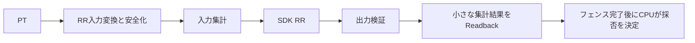

# RRQ-02: RR連続実行の安全性と所有権の設計

Status: design complete; implementation and SDK safety validation pending.

対象はWork4のPT RRです。RRQ-01の基準測定を受け、入力検証のCPU往復を
取り除くための実装契約を決めます。この文書の追加ではレンダラーの動作は変えません。
RRQ-03で試験実装、RRQ-04で異常系の復旧、RRQ-05で回帰検証を行います。

## 目的と比較基準

現在のeager方式は、検証済み出力を公開した直後に次のPTを開始できますが、
入力集計の完了をCPUが確認するまでSDKを記録できません。
[RRQ-01](rrq01-baseline-results.md)では入力確認後からSDK呼び出しまで約2.2～2.3ms、
SDK CPU呼び出しは平均約0.34～0.38msでした。入力待ち・出力待ちにはGPU実行と
ポーリング間隔も含まれるため、これらをそのまま削減可能なCPU時間とは扱いません。

最初の変更は、同じDirectキュー上で次を連続して記録・実行することです。

SDKのC++ APIはCPUでコマンドを記録します。GPU上の条件分岐でSDK呼び出しを
スキップする設計ではありません。GPUの入力判定結果をCPUが読む前にSDKを記録するため、
全画素を数値的に安全化してからSDKに読ませる必要があります。
SDKが成功しても、不正入力を含む出力は公開しません。

最初は1 productionのみ進行中、RR出力2スロットを維持します。
複数productionのリング化、Async Compute、NRDの変更、RR Upscaleは含めません。
GPUのフェンス確認自体は残し、毎表示フレームで新しいRR画像が得られるとは約束しません。

## 現在のコードから変える箇所

| 現状 | 連続実行の契約 |
|---|---|
| `PathTracingRrLive::RecordInput`後はInputPending | CPUメタデータ検証後、同じproductionでSDKまで記録可能にする |
| 入力・出力が同じ8バイトsummary/readbackを共有 | 識別子付きの独立集計領域に分け、両方を最終フェンスまで保持する |
| `Poll`で入力を読んでからEvaluateへ遷移 | `Poll`では入力・出力の両集計を一緒に確認して採否を決める |
| `History::Begin(..., inputsAdmitted=true)` | 未読GPU入力を「admitted」と偽装しない投機評価用APIを追加する |
| Evaluateパスは前フレームまでのWritingSlotを参照 | グラフ構築前に今回の書込みスロットを予約し、パス宣言と実際の書込みを一致させる |
| 入力拒否時はSDKが呼ばれない | 連続実行ではSDK履歴が進む可能性があるため、拒否後の次回SDKを必ずresetにする |

参照する実装は以下です。

- `Renderer/PathTracingRrLive.{h,cpp}`: production、集計、フェンス、公開出力。
- `Renderer/PathTracingRrHistory.{h,cpp}`: ticket、連続性、SDK履歴の確定。
- `Engine/RtPbrSurveyEnginePasses.cpp`: パス構築、PT入力保持、RRのresource usages。
- `Engine/RtPbrSurveyEngine.cpp`: メタデータ検証、変換定数、出力poison、姿勢スナップショット。
- `Shaders/RayReconstructionInputConversion.hlsli`: 変換と不正理由。
- `Shaders/shaders_PathTracingRrConversion.hlsl`: 8入力テクスチャとstatusの書込み。
- `Shaders/shaders_PathTracingRrValidation.hlsl`: mask/画素coverageの集計。
- `Renderer/StreamlineAdapter.cpp`: リソースタグ、SDK評価、状態宣言。

## 入力契約

### CPUで先に拒否するもの

SDK/backend有効性、材質の対応範囲、デバッグ出力、サンプリング方式、実寸、format、
resource identity、production stamp、行列・jitter・exposure・motion scale、出力aliasを
記録前に確認します。既存のmetadata/adapter検証は省略しません。
不正時はSDKを呼ばず、Nativeへフォールバックします。

変換callbackで初めて判明するhostGateもSDK記録直前に再確認します。
グラフ構築時に予定しただけではSDK実行の資格になりません。
未知のhostGateや不正な変換定数を代替画素で隠してSDKを呼ぶことは禁止します。

### GPUの最終書込みで保証するもの

共有のPT入力、Native画像、NRD入力には手を加えません。
RR専用の8テクスチャを書き込む既存dispatchの末尾に安全化を統合し、
別の全画面コピーや安全化用dispatchは追加しません。

1. 既存の変換を実行し、元のstatusを保存する。
2. 最終出力の全成分を検査する。算術の途中が有限でも最終結果が有限とは限らない。
3. 元のstatusが不正、または最終出力が契約外なら、8入力すべてを同じ代替組へ置換する。
4. statusは不正のまま残す。安全化できたことを「入力が正当」とは扱わない。
5. 部分的な置換を避け、深度・法線・motion等の整合した組を必ず全画素に書く。

初期試作の安全化プロファイルをv1として固定します。下記の上限はアプリ側の
保守的な実験範囲であり、NVIDIAが保証する一般的なSDK上限ではありません。
範囲を超えた正常なシーンも、この試作ではそのproductionを拒否します。
値を黙ってclampして正常扱いすることはしません。

| 入力 | v1の最終条件 | 不正画素の代替値 |
|---|---|---|
| Color RGBA32F | RGB有限、0～65504、alpha=1 | (0,0,0,1) |
| Diffuse Albedo RGBA32F | RGB有限、0～1、alpha=1 | (0,0,0,1) |
| Specular Albedo RGBA32F | RGB有限、0～65504、alpha=1 | (0,0,0,1) |
| Normal RGBA32F | xyz有限、単位長との差が0.002以下、alpha=0 | (0,0,1,0) |
| Roughness R32F | 有限、0～1 | 1 |
| Linear Depth R32F | 有限、0より大きく65504以下 | 1 |
| Motion RG32F | jitter除去・top-down UV変換後、各成分有限かつ-1～1、scale=(1,1) | (0,0) |
| Specular Hit Distance R32F | 有限、0～65504 | 0 |

既存のtraced miss sentinel=65504、距離なし=0の意味は維持します。
有限ヒットが65504を超える場合はmissへ変換せず拒否します。
status 1～6を保持し、元status=0で最終条件に違反した場合のみ新status=7
（numeric envelope rejection）を使います。既存集計は1～6以外をunknown bitへ
まとめるため、status=7用bitとテストを追加します。整数でないstatus等は従来通りunknownです。

現行の背景入力はnormal=(0,0,0)です。SDKガイドの正規化法線という条件と区別するため、
v1では「既存の背景判定を通過した画素」に限ってnormal=(0,0,1)とし、
既存の背景色・motion・depth sentinel・距離なしを保持します。
この背景guideの変更は画質差を生み得るので、スケジュール変更と一緒に効果を断定しません。
表面の正当な入力は変更せず、背景を含む比較は下記safe-serialを参照にします。

ゼロ埋めだけでは正の深度・正規化法線を満たしません。
また、有限性だけでSDK内部演算の安全性は証明できません。
v1の代替組・境界値を実SDKで試験し、未通過ならchainedを有効化しません。

## 集計領域とGPU順序

進行中productionごとに入力用・出力用の16バイトsummaryを独立に確保します。
各領域は`uint32 mask, coveredPixels, productionSerialLow, productionSerialHigh`です。
グラフ構築前に0以外の単調増加uint64 productionSerialを予約し、両検証dispatchへ渡します。
これはframeIdや履歴ticketとは別に、集計の今回の書込みを識別する番号です。
検証shaderのgroup 0/lane 0がserialを書き、全groupでmask/countをreduceします。
番号を使い切った場合は新規記録を拒否し、再利用しません。
readbackは32バイトの1領域とし、入力をoffset 0、出力をoffset 16へコピーします。
CPUは最終フェンス完了後に1回mapし、両serialが予約番号と一致することも確認します。
ゼロ初期化だけでは過去の正常集計の再利用を検出できないため、この識別子を省略しません。
zero uploadは読取り専用で共有できます。実際のバッファ配置のアラインメントは別途守ります。

- 各summaryをCOPY_DESTでゼロ化し、UAVへ遷移してreduce、COPY_SOURCEへ遷移してreadbackへコピー。
- 変換の8 UAV書込みからSDKのSRV読取りへ、明示的なtransitionを置く。
- SDKにタグ付けする入力stateは現行adapterと同じPIXEL_SHADER_RESOURCEに揃える。
- 出力はUAVでpoisonし、UAV barrierを置いてSDKを記録する。
- SDK出力をNON_PIXEL_SHADER_RESOURCEへ遷移して有限RGBとcoverageを検証する。
- その後のstateもRenderGraphの追跡と一致させ、SDKが変更したroot signature/heap等を復元する。
- 同じDirectキュー上の依存順序を保ち、CPUフェンス待ちやクロスキュー同期を挿入しない。

2つの16バイトsummaryと32バイトreadbackの論理サイズは小さく、
画像の複製は増やしません。ただしcommitted resourceの実割当量は論理サイズより大きくなります。

## production、公開、SDK履歴の契約

グラフ構築前に今回の出力スロットを予約し、そのスロットをパス宣言とcallbackへ渡します。
PT後にproduction key、定数、入力8資源、出力、姿勢snapshot、ticketを固定します。
公開済み出力と同じallocationを予約することは禁止します。

提案状態はIdle -> Recording -> PacketPending -> Idleです。
Recording中の部分失敗はDrainingRejectedへ進み、提出済みGPU仕事が完了するまで保持します。
Pauseは新productionだけを止め、進行中packetの完了確認を妨げません。

履歴APIには、GPU入力の採否未確定を表す明示的な投機開始と、
入力検証・SDK成功・出力検証をまとめて渡す完了処理を用意します。
既存`Begin(..., inputsAdmitted)`のtrueへ読み替える実装にはしません。
`Finish`で入力が不正でも成功履歴が確定する経路を作らないことが必須です。

| 完了時の条件 | 公開と次回の扱い |
|---|---|
| 両serial一致、入力mask=0、出力mask=0、両coverageがwidth*height、SDK成功、key/epoch一致 | 今回のticketを確定して公開、次のproductionへ |
| 入力不正、SDK成功でも出力有限 | 今回は公開禁止。inputRejectedを増やしSDK履歴をdirtyにする |
| 出力不正、coverage不足、SDK失敗 | 今回は公開禁止。理由を記録し履歴をdirtyにする |
| resize、scene変更、backend切替等でepoch不一致 | cancelledとして公開禁止。旧allocationを最終フェンスまで保持 |
| CPUメタデータ不正でSDK未試行 | SDKを呼ばずNative、理由を区別して記録 |
| device removed/信頼できる完了フェンスなし | 通常の再利用へ戻さず、既存device error経路に渡す |

拒否はSDKを巻き戻せません。SDKを一度でも試行したpacketを拒否・キャンセルしたら、
次のSDK呼び出しへhistoryReset=trueを渡します。次の有効packetが公開されるまで
dirtyを解除しません。再試行にも失敗した場合はresetを繰り返します。

同じepochなら直前の検証済み画像を保持できますが、その画像はretained/staleと明示し、
今回の成功としてcompletedを増やしません。現行のhistory helperのInvalidateと
公開済みallocationの保持を分離します。epoch変更後は旧RR画像を再利用せず、
Native画像を次のPTまで保持する既存の黒フレーム防止を守ります。
長期の不正入力では「RR正常」と表示せず、Nativeへ切り替えられる状態を維持します。

SDKの成功と公開の確定は別です。submittedを記録し損ねたpacket、同じfenceの二重確定、
古いticket、別productionの集計、公開済み出力の上書きはすべて拒否します。
キューへ出した可能性のあるpartial failureもフェンスでdrainしてから再利用します。

カメラ・インスタンスのprevious poseは公開したkey/snapshotと一致させます。
拒否した姿勢を次回の「公開済み履歴」として採用しません。
reset時は現行のreset用姿勢規則を適用し、SDK履歴だけを継続扱いにしません。

## 試験モードと観測値

既存strict/eagerの動作と既存CLIを維持します。chainedは初期状態OFFです。
追加するプロセス限定の診断選択（提案名`-PathTracingRrSchedule`）は以下です。
まだ実装済みコマンドではありません。

| 選択 | 入力変換 | CPU入力確認 | 用途 |
|---|---|---|---|
| strict/eager（既存） | 現行 | あり | RRQ-01との基準比較 |
| safe-serial（追加） | v1 | あり | 安全化・背景guide変更の影響だけを比較 |
| chained（追加） | v1 | 最終確認に統合 | safe-serialに対するスケジュール比較 |

新規モードはEvaluation Caseへ保存せず、既存RR有効化・透過実験の条件も緩めません。
診断ログにはschedule、入力プロファイル版、SDK試行数、成功公開数、入力拒否、
出力拒否、cancelled、retained age、履歴dirty/reset、final fenceを出します。

連続実行では「入力をCPUがadmitした時刻」が存在しないので、
inputWaitMs/admittedWaitMsへ従来と違う意味の数字を詰めません。
該当値はN/Aとし、packet開始→公開、SDK CPU時間、最終poll回数、GPU各パス時間を記録します。
比較スクリプトもschedule-awareに更新します。GPU欠測を0msへ置き換えません。

## RRQ-03以降の実装・検証順

| 順序 | 対象 | 達成条件 |
|---|---|---|
| 03-A | v1変換とstatus=7、GPU fixture | 全8入力の有限性・範囲・単位法線・不正理由保持・端数dispatchを検証 |
| 03-B | safe-serial、実SDK smoke | 代替画素と境界値がSDKへ渡ってもクラッシュせず、出力が有限。元不正packetは公開されない |
| 03-C | 独立summary、所有権、chained opt-in | 同一productionでPT/変換/SDKが1回ずつ、CPU入力待ちなし、公開判定は最終fence後 |
| 04 | 履歴dirty・拒否・キャンセル・部分失敗 | 不正packetの公開0、次回SDKはreset、古いallocationを早期再利用しない |
| 05 | lifecycle/negative回帰 | pause/resume、Native/NRD/RR、resize、scene変更、移動/停止、NaN/Inf/巨大値/coverage不足が通過 |
| 06 | 同一入力版でABBA・画像比較 | fresh RR/s、表示FPS、CPU/GPU、packet latency、retained ageを分離し画質も比較 |
| 07 | 採用判断 | 根拠と制限を記録し、未検証時はeagerを既定のまま保つ |

CPU単体ではticket、dirty/reset、完了結果の組合せ、古い集計拒否を検証します。
WARPでは変換とsummaryの数値契約を検証できますが、NVIDIA SDK動作の証明にはしません。
実GPUではall-invalid、single-invalid、背景、thin/smooth/rough glass、HDR、motion境界、
poison未書込み、SDK失敗を試します。D3D12 Debug Layerと可能ならGPU validationで
barrier・alias・lifetimeも確認し、性能はRelease/debug layer OFFで別測定します。

最初の採用条件は安全性の全項目合格です。性能の改善率は現時点で約束しません。
同一入力版のsafe-serial比で新しいRR出力が増えても、表示FPSや遅延・画質に
許容できない退行があれば既定化せず、原因を報告します。

## 根拠と未検証事項

ローカルSDKの`C:/work/third_party/streamline-sdk-2.12.0/docs/ProgrammingGuideDLSS_RR.md`
の4.1（入力資源）、6.0（定数とmotion scale）、7.0（評価位置とframe token一致）を確認しました。
正規化法線、線形albedo、dense motion、LinearDepthタグ等は同ガイドと現行adapterに合わせます。
代替組・65504の保守範囲・最終採否の方式はこのアプリの設計判断です。
SDKガイドに「任意の不正画素をこの値へ置換すれば安全」という保証があるわけではありません。

RRQ-02ではコード照合と設計の整理のみを実施しました。GPU試験や新しい速度結果はありません。
実装のbuild、SDK代替組検証、A/B画質、異常系・履歴復旧、最終採用は後続ステップです。
